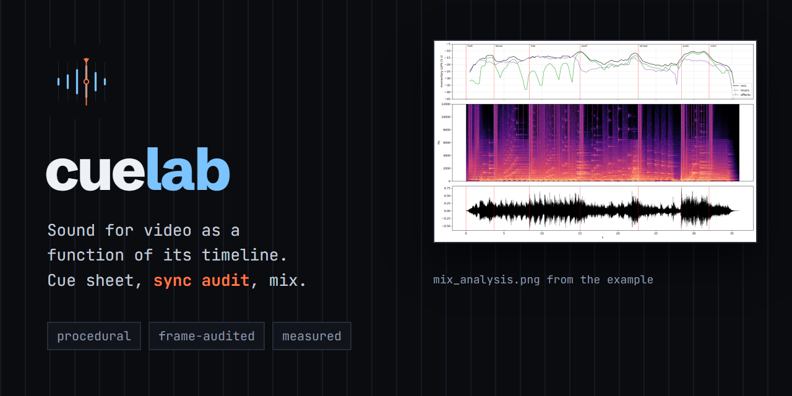
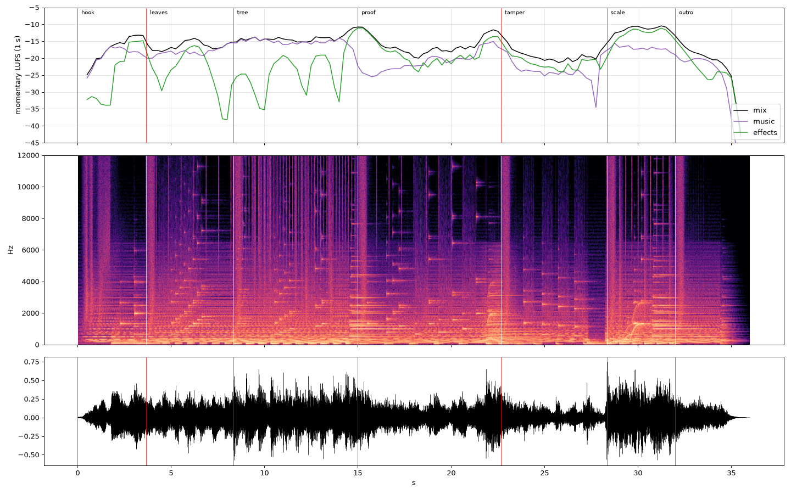

<p align="center"></p>

# cuelab

A Claude Code skill for **scoring a finished silent video the way you would test a system**. The picture is the specification. Every sound is a cue with a source (a frame constant in the picture's own code), everything is synthesized procedurally (numpy and scipy, no samples, no API keys), and the result is checked by **measuring the video**, not by trusting the numbers you typed.

You ask for "add sound to this video". The skill takes Claude through intake, a sound-direction note, a cue sheet derived from the video's timeline, a score, a mix and master to a loudness target, a **sync audit** that decodes the video and compares when things happen on screen with when the sound plays, quality checks (phone speaker, mono, clicks), and an AAC mux that is verified by decoding it back.

<p align="center"></p>

*The example (`examples/merkle-proof-scored`, 36 s, 161 cues): the silent Merkle-proof video from [sourceframe](https://github.com/endlessconflict/sourceframe) with sound added. [Download the video with sound](examples/merkle-proof-scored/out/video-sound.mp4), or read its [generated QA report](examples/merkle-proof-scored/out/QA_REPORT.md).*

## What the example proves, and what it does not

From the files in `examples/merkle-proof-scored/out` (regenerate with the command below):

| measurement | value |
|---|---|
| sync checks inside their tolerance window | 35 of 35 |
| integrated loudness | -15.0 LUFS (target -15.0; ffmpeg's meter reads -15.1) |
| loudness range | 7.0 LU |
| true peak | -1.71 dBTP (ceiling -1.5) |
| phone-speaker simulation (230 Hz high-pass) | loses 1.8 dB |
| mono sum | loses 0.94 dB, L/R correlation 0.68 |
| decoded AAC against the master | lag 0 samples at four points |
| cue to click onset (key, bit, ui cues) | mean +4.6 ms, p95 +22 ms |

And the parts that are not clean:

- **Nobody has listened to it.** The author of the code (an AI) cannot hear. The numbers say the sounds land on the right frames and that nothing clips; they do not say the piece sounds good. Listen before you publish.
- The click detector reports 1 unexplained discontinuity in the master (frame 366.3) and 2 in the music stem (146.0, 366.3). They have not been investigated.
- Focal sounds sit only +0.7 dB (median) over the music bed, with some below it.
- Seven of the 35 checks use a window wider than the default because the sound deliberately leads a slow-start motion. The windows are written next to each check in `checks.py`.
- The pre-limiter true peak is +0.8 dBTP at frame 656; the limiter is working there.

## Why this exists

Sound added to an AI-made video usually fails in one of four ways: **late or early** (a click a few frames off the thing it belongs to), **loud in the wrong places** (clipping, a limiter doing the mixing), **unmeasurable** (no way to say it is right), or **unrepeatable** (change the picture and start over). The method answers each:

| failure | the countermeasure |
|---|---|
| off the picture | every cue is derived from the picture's constants and easing curves (an exact port, with a command that tests it against Remotion's own `Easing.bezier`) |
| loudness | BS.1770 meter, energy arc, ducking from a tier-1 copy, look-ahead true-peak limiter, a list of the loudest frames to fix at the source |
| unmeasurable | the sync audit measures colour and luminance in regions of the decoded video and reports the offset of each cue in frames |
| unrepeatable | cues, score and checks are code; after a picture change the audit points at the cues that moved |

## What is in the box

- `skills/cuelab/SKILL.md`: the method, phases with gates, decision tables
- `skills/cuelab/references/`: sound direction, cue sheet, synthesis, music, mix and master, sync audit, quality checks, pitfalls, voice-over (design notes, untested), adapting
- `skills/cuelab/engine/`: the Python engine (`dsp`, `synth`, `cuelib`, `music_kit`, `mix`, `audit`, `quality`, `report`)
- `skills/cuelab/scripts/cuelab.py`: `new`, `build`, `audit`, `quality`, `report`, `all`, `ease-check`
- `skills/cuelab/templates/project/`: a project to start from
- `examples/merkle-proof-scored/`: the cue sheet, score, audit checks, the video and the generated reports

## Install

**As a Claude Code plugin:**

```
/plugin marketplace add endlessconflict/cuelab
/plugin install cuelab@cuelab
```

**Or manually:**

```bash
git clone https://github.com/endlessconflict/cuelab
bash cuelab/install.sh            # copies skills/cuelab to ~/.claude/skills/cuelab
# Windows PowerShell: ./cuelab/install.ps1
```

Requirements: Python 3.10+ with `numpy`, `scipy`, `matplotlib`; `ffmpeg` and `ffprobe` on the PATH; Node only for the optional easing check.

## Use it

Just ask:

> Add sound to out/video.mp4. LinkedIn, plays muted by default so the sound should reward people who turn it on. Timeline is in timeline.json.

Or by hand:

```bash
python skills/cuelab/scripts/cuelab.py new ./sound --video video.mp4 --timeline timeline.json
# edit sound/cues.py (cues), sound/music.py (score), sound/checks.py (audit)
python skills/cuelab/scripts/cuelab.py all ./sound      # build, audit, quality, report; exits 1 if a sync check fails
```

Reproduce the example (about two minutes):

```bash
pip install numpy scipy matplotlib
python skills/cuelab/scripts/cuelab.py all examples/merkle-proof-scored
```

## The method in one screen

Principles: **the picture is the specification · every cue has a source · measure the video, not the plan · fix loud moments at the cue, not with the limiter · say what was not heard.**

Phases: intake, sound direction, cue sheet, effects, score, mix, audit, quality, mux, delivery. Each has a gate (see `skills/cuelab/SKILL.md`).

## Honest limits

- It builds **synthesized, interface-style sound** for explainers: pings, ticks, whooshes, pads, simple grooves. It is not an orchestral or acoustic scoring tool.
- Frame accuracy is measured within tolerance windows of one to a few frames, not to the sample.
- It needs the picture's timing as data. For a video made without a timeline, cues have to be derived from measurement and the guarantee is weaker.
- Voice-over is only outlined in `references/09-voiceover.md`. No voice was generated, and no text-to-speech service was tested.
- The examples were checked with measurements and never auditioned by ear.

## Credits

Built by [endlessconflict](https://github.com/endlessconflict) with Claude. Companion to [sourceframe](https://github.com/endlessconflict/sourceframe) (the video side). The easing check runs against [Remotion](https://www.remotion.dev) (not MIT: free for individuals and teams of up to three, see remotion.pro/license). The numerical work is [NumPy](https://numpy.org), [SciPy](https://scipy.org) and [Matplotlib](https://matplotlib.org); the container work is [FFmpeg](https://ffmpeg.org). Loudness follows ITU-R BS.1770 and EBU R128 / Tech 3342. Full list in [CREDITS.md](CREDITS.md).

## Licence

MIT, see [LICENSE](LICENSE). Third-party notices in [CREDITS.md](CREDITS.md).
